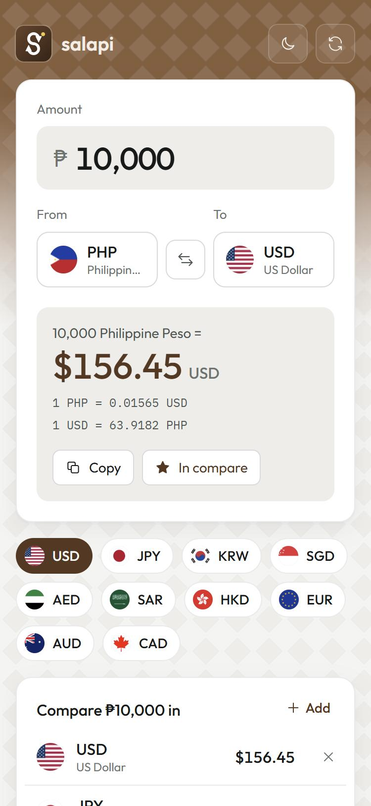
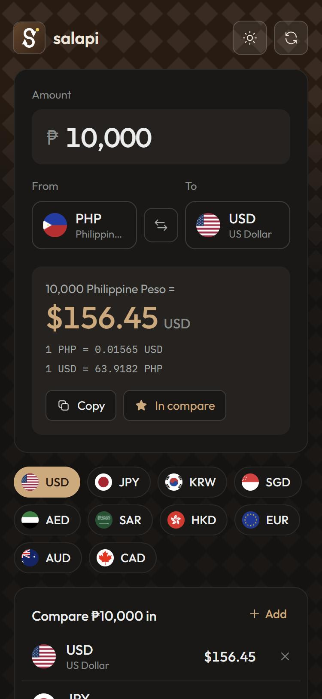
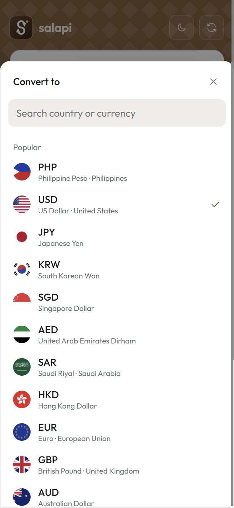
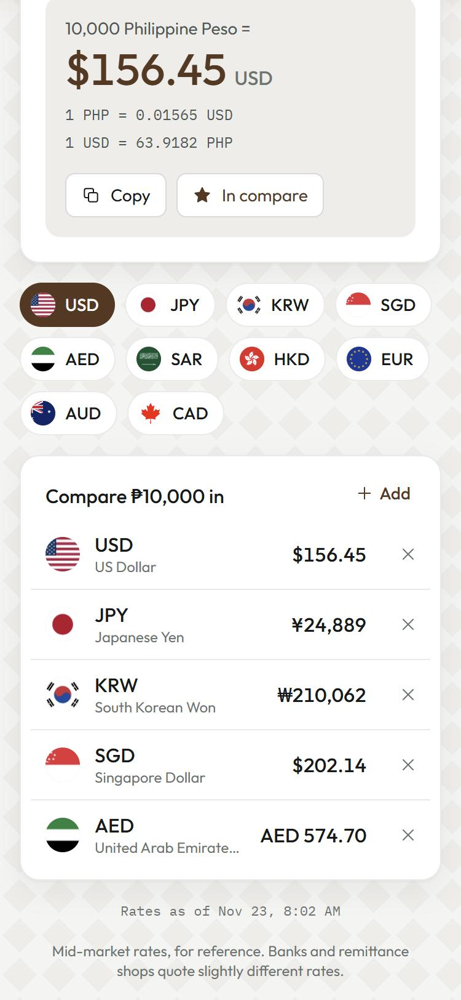

<p align="center">
  
</p>

<h1 align="center">salapi</h1>

<p align="center">See how far your pesos go, in any currency, in a couple of taps.</p>

<p align="center"><a href="https://salapi-exchange.vercel.app/"><strong>Try it live → salapi-exchange.vercel.app</strong></a></p>

<p align="center">
  
  &nbsp;&nbsp;
  
</p>

---

## What is Salapi?

Salapi is a simple money converter that puts the **Philippine peso first**. Type an amount in pesos and you instantly see what it's worth in US dollars, yen, won, dirhams, or any of 160+ other currencies, using today's exchange rates.

It's handy whenever you're thinking in pesos:

- **Sending or receiving money** from abroad, and want a quick sense of the real value
- **Planning a trip** and budgeting in the local currency
- **Shopping online** from stores that price in another currency
- **Getting paid** by clients or employers overseas

There's nothing to sign up for and nothing to install. [Open it](https://salapi-exchange.vercel.app/) and start typing.

*Salapi* is an old Tagalog word for money.

## What you can do

- **Convert as you type.** The result updates with every number, with the rate shown both ways (1 PHP = … and 1 USD = …).
- **Find any currency fast.** Search by country, currency or even a city. "japan", "uk" and "dubai" all work.
- **Flip it around.** One tap on the swap button converts the other way, for example dollars back to pesos.
- **Jump to common currencies.** Quick-pick buttons for USD, JPY, KRW, SGD, AED, SAR, HKD, EUR, AUD and CAD.
- **Compare several at once.** Star the currencies you care about and see your amount in all of them side by side.
- **Copy the result** with one tap, ready to paste into a chat or a note.
- **Light or dark.** It follows your phone's setting, and the moon/sun button switches it any time.
- **Keeps working offline.** It remembers the last rates it loaded, plus your currencies and amount.

<p align="center">
  
  &nbsp;&nbsp;
  
</p>
<p align="center"><sub>Pick from 160+ currencies, or compare one amount across your favorites</sub></p>

## Good to know

- **These are market rates.** Salapi shows the mid-market rate, the "real" rate between banks, updated about once a day. Banks, money changers and remittance apps usually give you a bit less, so treat Salapi as a reference, not a quote.
- **Your data stays with you.** There are no accounts, ads, cookies or tracking. Your currencies and the saved rates live only in your own browser.

---

## For developers

Salapi is plain HTML, CSS and JavaScript. No framework, no build step, no API keys.

### How rates work

Rates are fetched in the browser from free, keyless sources, falling back to the next one if a source is down:

1. [ExchangeRate-API open access](https://www.exchangerate-api.com/docs/free) (`open.er-api.com`)
2. [fawazahmed0/exchange-api](https://github.com/fawazahmed0/exchange-api) via jsDelivr
3. The same API's Cloudflare mirror

The latest rates are cached in `localStorage` and refreshed when they're more than an hour old.

### Privacy details

- No API keys, accounts, cookies or analytics
- Preferences, theme choice and cached rates are stored only in `localStorage`
- Requests to the rate APIs and the flag images (flagcdn.com) send no referrer
- A strict Content Security Policy limits the page to those hosts plus Google Fonts

### Run locally

Serve the folder with any static server:

```bash
python -m http.server 5173
```

Then open http://localhost:5173.

### Deploy

Import the repo into [Vercel](https://vercel.com/new). There are no build settings to change: the framework preset is "Other" and the output is the repo root. `vercel.json` adds a few security headers.

### Files

| File | What it does |
| --- | --- |
| `index.html` | Page markup and Content Security Policy |
| `style.css` | Styles, light and dark |
| `app.js` | Rate fetching, conversion and UI |
| `assets/logo.svg` | Logo and favicon |
| `assets/screenshots/` | Images used in this README |
| `vercel.json` | Security headers for Vercel |
| `plans/` | Animation audit plans (all done) |
